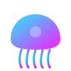

<a id="top"></a>

<div align="center">
    
    <h1><strong>🪼 Hydrozoa</strong></h1>
    <p><b>High-Performance Repository Mirroring Engine</b></p>
    
    <br>
    <p>
        <a href="https://gitlab.com/sgkens/hydrozoa"></a>
        <a href="https://hub.docker.com/r/sgkens/hydrozoa"></a>
        <a href="LICENSE"></a>
        
    </p>
    <hr>
    <p>Synchronize code, issues, milestones, and releases across GitHub, GitLab, Bitbucket, and Gitea with deep-sea precision and real-time telemetry.</p>
    <span>
        <a href="#features">Features</a> |
        <a href="#installation">Installation</a> | 
        <a href="#api-reference">API</a> |
        <a href="#contributing">Contributing</a> |
        <a href="#support">Support</a>
    </span>
    <hr>
</div>

## **Features**

🟦 **Multi-Provider Mirroring**: Sync repositories between GitHub, GitLab, Gogs, Gitea, Forgejo, and Bitbucket.
🟩 **Bioluminescent Dashboard**: Real-time telemetry and sync metrics visualized with high-end animations.
🔸 **Source Selection Matrix**: Hierarchical selection of namespaces and repositories for granular mirroring control.
🔹 **Dead Letter Queue (DLQ)**: Automatic capture of failed syncs with one-click replay functionality.
💠 **Bilingual Logs**: Logs translated into both human-readable resolutions and technical stack traces.
🔄 **Bidirectional Sync**: Support for two-way synchronization between providers.
🟦 **AES-256-GCM Encryption**: All provider tokens are encrypted at rest using industry-standard encryption.
🟩 **JWT Authentication**: Secure access control for all API and UI interactions.

<div align="right"><a href="#top"><small><code>⁛</code> Back to top</small></a></div>

![hr][rainbow-line]

## **Installation**

### **1. Bare Metal (Linux / macOS)**
Ensure you have **Node.js v20+** or **Bun** installed.

```bash
# Run the automated installer
chmod +x install.sh
./install.sh

# Start the application
npm start
```

### **2. Docker**
```bash
# Using the helper script
chmod +x docker/docker-run.sh
./docker/docker-run.sh

# OR using Docker Compose
docker-compose -f docker/docker-compose.yaml up -d
```

<div align="right"><a href="#top"><small><code>⁛</code> Back to top</small></a></div>

![hr][rainbow-line]

## **🔗 Links**

- 🦊 [GitLab Repository](https://gitlab.com/sgkens/hydrozoa)
- 🐛 [Issue Tracker](https://gitlab.com/sgkens/hydrozoa/-/issues)
- 🏗️ [CI/CD Pipelines](https://gitlab.com/sgkens/hydrozoa/-/pipelines)

<div align="right"><a href="#top"><small><code>⁛</code> Back to top</small></a></div>

![hr][rainbow-line]

## **API Reference**

Hydrozoa is built with a **"Headless First"** philosophy. You can bypass the GUI entirely using the REST API.

### **Authentication**
All requests (except login) require a `Bearer` token in the `Authorization` header.

**POST** `/api/v1/auth/login`
```json
{
  "email": "admin@hydrozoa.io",
  "password": "hydrozoa-default"
}
```

### **Endpoints**
- **GET** `/api/v1/system/sync-matrix`: Retrieve the current status of all mirror pairs.
- **GET** `/api/v1/system/dlq`: List items in the Dead Letter Queue.
- **POST** `/api/v1/system/dlq/:id/replay`: Re-trigger a failed sync operation.
- **GET** `/health`: Check system health and database connectivity.

<div align="right"><a href="#top"><small><code>⁛</code> Back to top</small></a></div>

![hr][rainbow-line]

## **Contributing**

Feel free to contribute! Fork the repo and submit a **merge request** with your improvements. Or, open an **issue** with the `enhancement` tag to discuss ideas.

1. **Fork the Project** and clone it: `git clone https://gitlab.com/YOUR_USERNAME/hydrozoa.git`
2. **Switch to dev** and create your branch: `git checkout develop; git checkout -b feature/AmazingFeature`
3. **Commit your changes**: `git commit -m 'feat: Add some AmazingFeature'`
4. **Push to the branch**: `git push origin feature/AmazingFeature`
5. **Open a Merge Request**:
   
   [](https://gitlab.com/sgkens/hydrozoa/-/merge_requests/new)

<div align="right"><a href="#top"><small><code>⁛</code> Back to top</small></a></div>

![hr][rainbow-line]

## **Acknowledgments**

🔹 [**@framer/motion**](https://www.framer.com/motion/) - For the bioluminescent UI animations.
🔹 [**@lucide-react**](https://lucide.dev/) - For the beautiful consistent iconography.
🔹 [**@apexcharts**](https://apexcharts.com/) - For real-time telemetry visualization.
🔹 [**@bun**](https://bun.sh/) - For high-performance JavaScript runtime support.
🔹 [**@shields.io**](https://shields.io/) - For the dynamic project badges.

<div align="right"><a href="#top"><small><code>⁛</code> Back to top</small></a></div>

![hr][rainbow-line]

## **Support**

- 📝 [Documentation](https://gitlab.com/sgkens/hydrozoa/-/wikis/home)
- 🐛 [Issue Tracker](https://gitlab.com/sgkens/hydrozoa/-/issues)
- 💬 [Discussions](https://gitlab.com/sgkens/hydrozoa/-/issues)

<div align="right"><a href="#top"><small><code>⁛</code> Back to top</small></a></div>

![hr][rainbow-line]

## **📑 License**

This project is licensed under the MIT Licence, see the [LICENSE](LICENSE) file for details.

[rainbow-line]: https://raw.githubusercontent.com/phellams/phellams-general-resources/main/misc/hr/skewed-rectangles-divided.svg
